<p align="center">

</p>

<h1 align="center">
Vima v1.5.0 Manual
</h1>

<p align="center">
  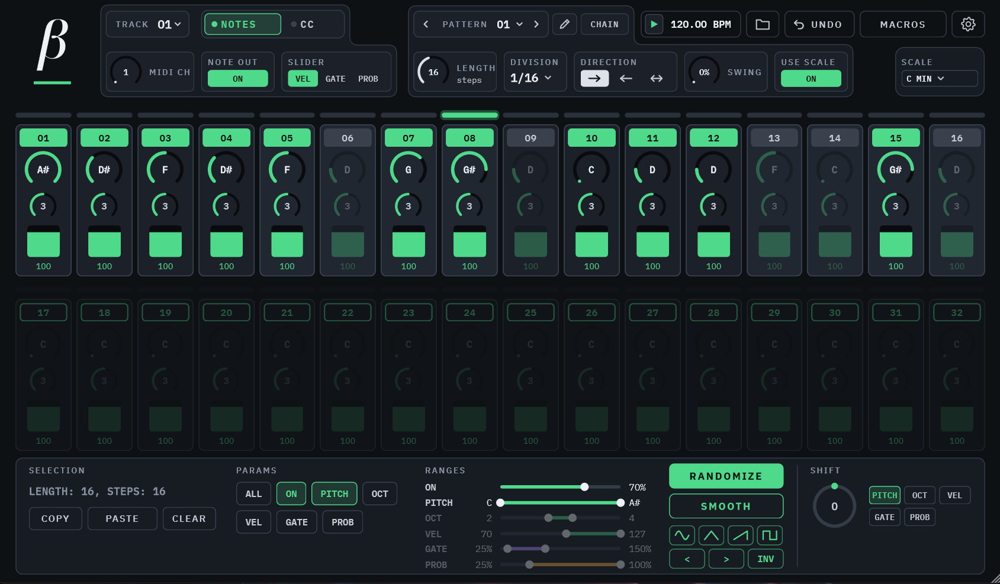
</p>

## Vima - the VST step sequencer to kill all VST step sequencers

**Vima** (from the Greek word "βήμα", which means **step**) is an **8-track melodic MIDI step sequencer** that runs as a plugin (VST3) inside your DAW. It makes no sound of its own: it plays notes and sends CC (controller) messages into the instruments and effects you already use. It's focused on being easy to use while still providing extensive capabilities in an uncluttered UI.

Each of its 8 tracks has up to 32 steps, its own length, timing and direction, and can play notes, send a CC value, or both at once. You can store 64 patterns, chain them into a longer arrangement, switch between them live, and automate almost everything from your DAW.

Attention has been given to what I like to call **guided randomization**. Randomness is a great way to find ideas you would never have played yourself, but pure chance is rarely musical. In Vima you steer it by using selected steps and parameters and controlling the randomization output with ranges, smoothing and pre-defined curves.

UNDO - REDO is always one click away so Vima encourages experimentation.

## Who am I - disclaimer

I have been a music software - MIDI freak for a long time. Under the name "Softcore" I wrote electronic music and built a lot of software little helpers (MaxForLive, Lemur templates, Reaktor instruments etc.): Microtonic Lemurized (2013), was a Lemur template which turned Sonic Charge's Microtonic into a complete touch instrument with per-parameter exclusion randomizing; its developer, Magnus Lidström, called it "absolutely amazing" (https://soniccharge.com/forum/topic/383-microtonic-lemuriized). I was one of the first to buy Zaquencer - the custom firmware which transformed the BCR2000 into a full-blown sequencer (which also inspired this VST), and Bome MIDI Translator glued my setups together for years, performing hybrid DJ - Live techno sets for many years.

So, even though I've dipped my toes into coding I am not a C++ developer. I always had ideas about what I want the software to do but never got round to actually learning a proper coding language (Lemur scripting was close to that though).

**Vima was vibe-coded**: I designed it, decision by decision, and an AI (Claude by Anthropic) wrote the code for JUCE, which I tested in real sessions and sent back with notes until it behaved the way I wanted. Every choice you will find in Vima was made on purpose by me. Throughout this manual I'll be explaining various design choices and the reasoning behind them. Furthermore, Vima is not processing any audio so there is no DSP processing which is something I would not trust to an AI without personal knowledge.

## Installing and setting up

- Get Vima for your platform from the [latest release](https://github.com/TheoGal/vima-vst/releases/latest) and unzip it.
- **Windows:** copy the `Vima.vst3` folder to `C:\Program Files\Common Files\VST3\`.
- **macOS:** copy `Vima.vst3` to `/Library/Audio/Plug-Ins/VST3/`. Test builds are not notarized by Apple, so the first time you may need to remove the quarantine flag (see INSTALL-macOS.txt in the download).
- **Linux:** copy the `Vima.vst3` folder to `~/.vst3/` (just for you) or `/usr/lib/vst3/` (for all users). Create the folder if it does not exist yet. Bitwig Studio and Reaper both host Vima on Linux.

Vima is a VST3 plugin only. There is no Audio Unit version, because an AU plugin cannot send MIDI out.

### Getting MIDI out of Vima

Your DAW lists Vima as an **instrument**. Put it on its own track, then route that track's MIDI output to the instruments you want to play.

>**design choice:** Vima is on purpose designed to be recognized by DAWs as an **"instrument"** as this is the most compatible format to be able to get MIDI data out of a VST plugin and "MIDI FX plugins" is a very limited format. 

**Ableton Live:** Add Vima to your project as an instrument track. On the target instrument track (the instrument you wish to control), set "MIDI From" to the Vima track, choose Vima in the lower chooser, and set monitoring to "In".
Other DAWs have a similar "MIDI input from another track" option.

**Note for Ableton Live users.** Live strips the MIDI channel from MIDI data internally. All 8 tracks of one Vima arrive mixed together on the receiving track, whatever their MIDI channels. So in Live, use **one Vima per instrument track**: its 8 tracks can still play that one instrument and create complex polyrhythmic patterns. (Hosts such as Bitwig and Reaper keep the channels, so there one Vima can feed several instruments by channel. In Live, that would need a Max for Live device.)

<p align="center">
  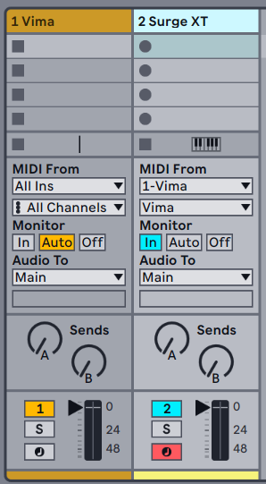<br>
  <em>Vima setup in Ableton Live</em>
</p>


## The steps view

The main window (the **steps view**) shows one track of one pattern at a time. 

The plugin window can be resized by dragging its bottom right corner, from 75% to 200%. The size is remembered with your project.

The step sequencer consists of two rows of 16 steps, each row with a thin **LED bar** above it which serves as a "playhead" - it's the sequencer's "running light". Steps which are off are dimmed. Steps beyond the track length are faded out and are not played.

<p align="center">
  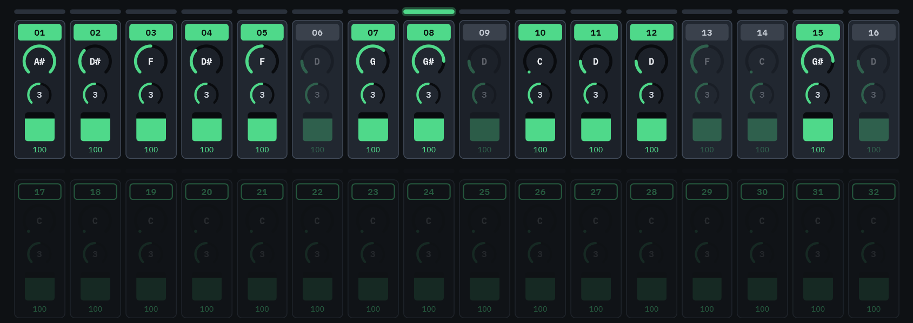<br>
  <em>Vima steps in Note mode</em>
</p>


There are two modes available: **Note Mode** and **CC Mode** which share the same length, time division and direction. 

- In **note mode** the steps show pitch and octave knobs and one slider (velocity, gate or probability).
- In **CC mode** each step shows one tall slider: its CC value (VAL) or its CC probability (PROB).

<p align="center">
  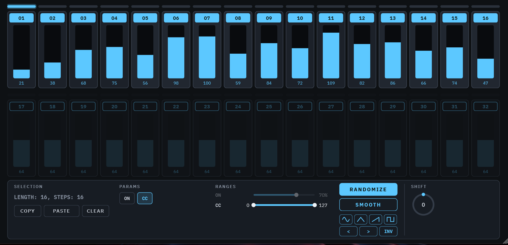<br>
  <em>Vima steps in CC mode</em>
</p>

Each of the modes can be set to output MIDI messages or not - so a sequence (a track) can output only notes, only CC values or both.

### Steps in detail

**note mode:**

 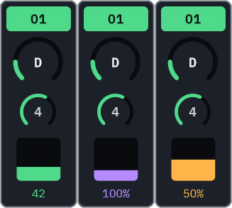

 - **The step on-off button**: click to switch the step's note on or off. Lit = on, grey = off. **Drag across several step buttons to paint**: start on an off step and every step you pass turns on; start on an on step and every step you pass turns off.
- **The pitch knob**: Select what note to play. With the scale on, it only lands on notes in the scale.
- **The octave knob**.
- **The slider**: velocity, gate or probability, as chosen with SLIDER *(see also Track controls)*, in that value's color. **Click and drag across several sliders to draw** a shape in one move.

 <br clear="left"><br />
 
**CC mode:** 

 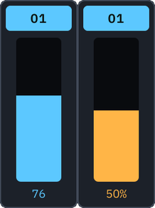

 - **The step on-off button**: click to switch the step's CC on or off.
 - **The slider**: VAL (the CC value this step sends) or PROB (the chance it is sent), as chosen with SLIDER *(see also Track controls)*. VAL is cyan, PROB amber like the note probability. **Click and drag across several sliders to draw** here too.

 <br clear="left"><br />


### What a step holds

| Mode | Value | Range | What it does |
|---|---|---|---|
| Note mode | Note on / off | | Whether the step triggers a note. |
| CC mode | CC on / off | | Whether the step sends its CC value. Independent of the note on-off. |
| Note mode | Pitch | C to B | The note name. With the scale on, only notes in the scale. |
| Note mode | Octave | C-2 to 8 (with middle C = C3) | The whole MIDI range. |
| Note mode | Velocity | 1-127 | How hard the note is played *(actually it's how fast a key travelled when played on a physical piano keyboard, but let's not get into that)*. |
| Note mode | Gate | 1-400% | How long the note lasts, in steps: 100% is one step, 50% half a step, 400% four steps (legato and long notes). |
| Note mode | Probability | 1-100% | The chance that the note plays each time the step comes round.|
| CC mode | VAL (CC value) | 0-127 | The value sent when the step's CC is on. |
| CC mode | PROB (CC probability) | 1-100% | The chance that the CC value is sent each time the step comes round. Rolled on its own, apart from the note probability. |

- **Long gates** (over 100%) let notes overlap into the next steps. This is particularly useful with monophonic synths that have a legato ("slide") option: when a held note overlaps a next note with a different pitch, the synth glides (portamento) into it. If the same note plays again on the same channel while the old one is still held, the old one ends just before the new one starts, so nothing gets stuck.

>**design choice:** You might have noticed that velocity and probability ranges do not include a 0 value. A MIDI note on message with velocity 0 is actually a Note off and a 0 probability is actually "never" hence the design choices here.

**Mouse control for knobs and sliders:**

- Drag up / down to change a value. Hold **Shift** for fine control.
- The **mouse wheel** changes one value per notch.
- **Double-click** to type a value. Notes can be typed by name (C, D#, A#).
- **Right-click** (or Alt + click) resets to the default.

## Tracks and patterns

You can create up to 8 completely individual sequences by using Vima's **tracks**. Furthermore you can "jump" to different sequences or chain them into longer ones by using **patterns**. You can think of it like this: a track can be set (via its MIDI channel output) to control a specific instrument in your DAW while patterns can be used to provide variations of what each instrument plays and build long sequences. 

### The track controls

Vima has **8 tracks**, shown as 01 to 08. Each one has its own MIDI channel assigned and its **note** and **cc** modes. Its related parameters can be adjusted at the top of the plugin, in the **track controls**.

<p align="center">
  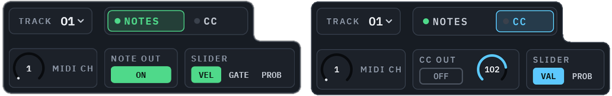
</p>

- **TRACK**: pick which of the 8 tracks you see and edit.
- **NOTES / CC**: switch between note mode and CC mode. Each button has a small light showing whether that output (notes or CC) is on for this track.
- **MIDI CH** (1-16): the channel the track plays on. Any track can use any channel, and several tracks can share one.<br />
**In note mode:** 
- **NOTE OUT** (on / off): whether the track's notes are sent.
- **SLIDER**: which value the step sliders show: VELocity, GATE or PROBability.<br />
**In CC mode:**
- **CC OUT** (on / off): whether the track's CC values are sent. Independent of NOTE OUT.
- **CC NUM** (0-127): the small knob next to the CC OUT button: which controller the track's CC part sends. One CC per track, on the track's MIDI channel.
- **SLIDER**: which value the step sliders show: VAL (the CC value) or PROB (the CC probability).

>**design choice:** A new Vima starts with track 1 playing notes on channel 1 (so you can quickly check if MIDI routing in your DAW is set correctly and an instrument is receiving notes). Tracks 2-8 start empty but with their notes output on, so a step you switch on is heard at once. CC output is off and CC numbers 102-109 are assigned to all 8 tracks (numbers that are unassigned in the MIDI standard). So loading Vima won't accidentally mess up your carefully designed synth sound. The tracks are assigned to MIDI channels 1 to 8.

### The pattern controls

Vima holds **64 patterns**, numbered 01 to 64 and shown in four pages of 16. A pattern contains all 8 tracks: their steps and their settings.

<p align="center">
  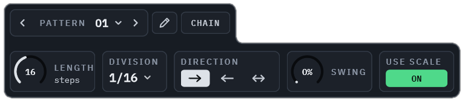
</p>

 These parameters can be adjusted at the top of the plugin, in the **pattern controls** - Changing, copying and chaining patterns is covered in detail later, in **Working with patterns**.

- **PATTERN**: the pattern you are looking at. The ‹ and › arrows step to the previous / next pattern; clicking the number opens a quick picker with all 64 patterns and a button to open the patterns view.
- **PATTERN EDIT MODE** (pencil icon): lets you edit one pattern while another one plays.
- **CHAIN**: switches chain playback on and off.
- **LENGTH** (4-32 steps): How many steps a pattern has. Steps beyond the length are dimmed and not played. Different lengths on different tracks give you polyrhythms.
- **DIVISION**: how long one step is: 1/1, 1/2, 1/4, 1/8, 1/16, 1/32, and the triplets 1/2T to 1/32T.
- **DIRECTION**: forward, backward or ping-pong. Ping-pong plays the end steps once.
- **SWING** (0-100%): delays every second step. 0% is straight; 100% delays it by half a step.
- **USE SCALE** (on / off): whether this track follows the global scale in this pattern.

Clicking on **PATTERN** opens a pop up to quickly select one of the 64 patterns.

<p align="center">
  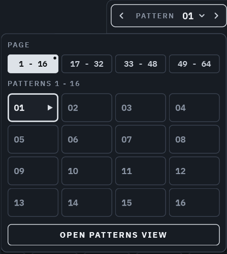
</p>

>**design choice:** As you might have grasped by the above, **Note Mode** and **CC mode** of a track in a pattern share the same length, time division and sequencer direction. This is on purpose to make sequenced patterns easy to create and maintain - you can, for example, create a simple 1 bar phrase and control a synth parameter at the same time. Want a CC rhythm that runs at a different length or speed than the notes? Use a second track on the same MIDI channel with only its CC output on.

>**design choice:** Controls are visually grouped and color coded according to their scope
>
>- **White / neutral**: settings for the whole track, pattern or the whole instance (length, division, direction, swing, MIDI channel, scale).
>- **Green**: the note part (note steps, notes, octaves, velocity, NOTE OUT, USE SCALE).
>- **Cyan**: the CC part (CC steps, CC values, CC NUM, CC OUT).
>- **Purple**: gate. **Amber**: probability (of the notes in note mode, of the CC values in CC mode).


## Step operations

The **operations panel** at the bottom holds the tools that change many steps at once.

<p align="center">
  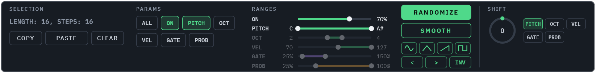
</p>

Two things decide what every function (copy, randomize, smooth, shift, curves...) changes:

- **Which steps**: the selection (or all steps)
- **Which values**: the **PARAMS** buttons.

### SELECTION section

By default, **step operations** act on all the steps visible and inside the length range. You can however select specific steps by using the "playhead" LED bar above each step row which also functions as a selector.

- **Click** one LED to select that step. **Drag** to select a run of steps.
- **Ctrl + click** (Cmd + click on Mac) adds or removes a single step, so you can select steps that are not next to each other. **Ctrl + drag** adds a run.
- Selected steps show as **white** LEDs.

**The scope rule.** Every step operation in Vima (copy, randomize, smooth, shift, curves...) works on **the selected steps, or on all steps of the track if nothing is selected**. The SELECTION box in the operations panel always tells you what that is, for example "LENGTH: 7, STEPS: 6".

<p align="center">
  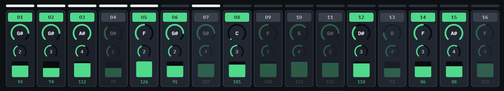<br>
      <em>Steps 1,2,3,4,5 and 7 selected, LENGTH: 7, STEPS: 6</em>
</p>

### PARAMS section

 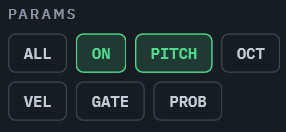

You can select which parameters to "arm" for operation - for example you might want to randomize notes, but not octaves or step on - off and velocities but not anything else. 
In note mode: **ALL, ON, PITCH, OCT, VEL, GATE, PROB**. In CC mode **ON**, **VAL** and **PROB**. Note mode and CC mode remember their own choice.
<br clear="left"><br />

PARAMS are shared by COPY-PASTE, RANDOMIZE, SMOOTH and the CURVES. By default, note on - off and pitch are armed for quickly generating melodies.

### COPY and PASTE steps parameters

After having selected desired steps and params, you can copy - paste them with the **copy** and **paste** buttons.

1. Select steps (or none for all), arm the PARAMS you want to copy, press **COPY**. It lights up as **COPIED**.
2. Click an LED to pick the **landing step**: a ghost preview shows where the steps will land. Copied steps keep their spacing.
3. Press **PASTE**. COPIED stays lit, so you can switch track or pattern and paste again.
4. Click **COPIED** or **CLEAR** to clear the clipboard.

Only the armed params are copied. So you can copy just the rhythm (ON), just the notes (PITCH), just the velocities, or everything (ALL). A paste that runs past the end of the track is cut off; it never wraps round.

### RANGES section

 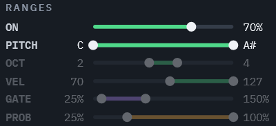

The range bars define the min - max values a parameter can acquire after an operation. Ranges of values that are not armed are dimmed. Obviously steps on-off do not have a range bar - instead they feature a **"chance"** parameter which defines how probable it is to have a step "on" after a randomization, e.g. with a 50% chance, it's pure random if a step is on or off - with a 70% chance steps are more likely to be "on". Keep in mind, a 50% chance doesn't necessarily mean 50% of the steps will be on, each step is randomized independently *(this will be important to remember further down the operations)*
<br clear="left"><br />

**Right-click** (or Alt + click) on a range bar resets it to its default.

The **PITCH** range follows the scale: with the scale on, it shows only the notes of the scale. It is a range of note names (it applies to every octave), so "D to G" means only D, D#, E, F, F#, G in any octave (in C minor: D, D#, F, G).

Again, velocity and probability ranges do not include a 0 value. A MIDI note on message with velocity 0 is actually a Note off and a 0 probability is actually "never".

>**design choice:** Default ranges are not set to their full but rather to practical settings most likely to produce musically interesting patterns.

### RANDOMIZE

Gives the armed values of the steps in scope new random values, within their ranges.

- **ON**: each step is switched on with a chance defined by the "chance" bar.
- **PITCH**: random notes from the PITCH range, in the scale when the track's scale is on.
- Randomize includes steps that are off (they get new values too, ready for when you switch them on).

Each press is one undo step, so you can press, listen, undo, press again - redo is always an option (right-click Undo).

>**Guided randomization in practice:** select steps 9-16, arm only VEL, set the VEL range to 60-110, press RANDOMIZE. Only the velocities of the second half change, and only within a musical range.

### SMOOTH

When working with extreme ranges, it's quite often - especially with parameters like velocity and CC values which drive synthesizer parameters thus the actual sound produced - that a result is somewhat desired but makes too extreme changes to the sound. Think for example velocity or a CC value driving a filter cut off. Having used full range min - max values may result in too extreme changes. Surely you could just limit the min - max values but what if the random pattern produced is actually desired but just too extreme?<br/>  
Meet **Smooth:** it pulls the armed values one step closer to their average. In other words, with a velocity range of 1 - 127, lower randomly produced values will rise by 1 toward 64 while higher ones will fall by 1 toward 64. Press once for a small nudge; **press and hold** to keep smoothing until the values meet the average. The whole operation is great for taming a wild randomize result without losing its character.

- Smooth in steps on - off works based on the "chance" setting: remember how I mentioned above that a 50% chance doesn't necessarily mean precisely half the steps will be "on". It might happen in a pattern with length 16, 7 steps are on or 10 steps are on. Smooth will add randomly an "on" step if the total is less than the chance, will subtract randomly an "on" step if the total is more than the chance. In our examples, the 7 on steps will become 8 and the 10 steps on will become 9.

- Notes are smoothed in scale steps, across octave boundaries.
- Smooth never goes outside the values you already have.

>**design choice:** When using smooth, the actual values of the armed parameters are taken into consideration excluding the steps which are "off". This is by design to actually smooth out (calculate an average) based on the "audible" parameters. Then the "smoothing" is applied to all steps (not only the on ones) so if you happen to switch a step to on, its parameters will be near the already "on" steps.

### Curves, rotate and invert

Under RANDOMIZE and SMOOTH buttons, there are 4 buttons with predefined curves to apply to parameters.

- **Shapes**: **SINE**, **TRIANGLE**, **RAMP** and **SQUARE** draw one cycle of that shape over the steps in scope, between each armed value's range limits. Want a ramp down? RAMP, then INV.
- With **ON** armed, the curves follow the **chance** setting: a step is on where the curve is above 100% minus the chance. With a 50% chance the upper half of the curve is on, with 70% everything above 30%, with 25% only the top quarter.
- **‹ ›** (rotate): moves the armed values one step left or right, the end wrapping round to the start. Arm only ON to shift the rhythm under fixed notes, or only PITCH to move the melody over a fixed rhythm. Having applied a curve, **rotate** helps timing the curve's phase as desired.
- **INV** (invert): flips the armed values around the middle of their range. With a VAL range of 0-100, 30 becomes 70.

Each press is one undo step.

<p align="center">
  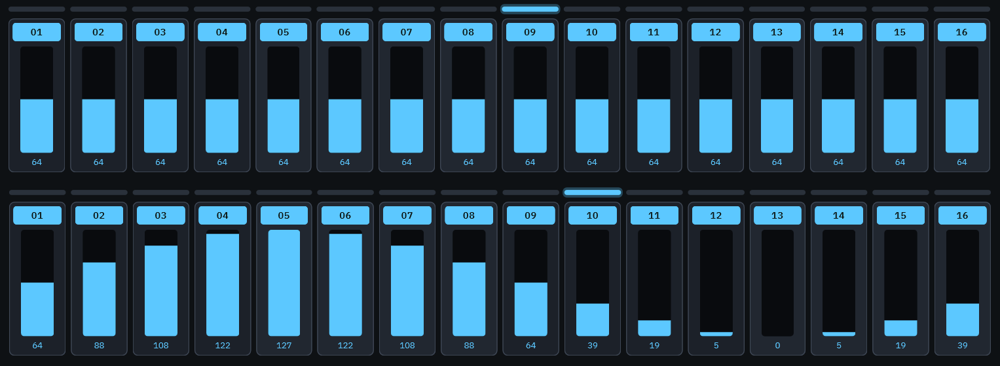<br>
  <em>Sine curve (bottom) applied to a row of steps in CC mode</em>
</p>

### SHIFT

Finally, the **Shift** knob is an endless knob that moves one value of all steps in scope up or down together, keeping the shape: PITCH (in scale steps), OCT, VEL, GATE or PROB in note mode, VAL or PROB in CC mode. Shift works with its own parameters selection which is exclusive - you cannot shift ALL parameters at once. 

>**design choice:** Steps on - off are not an option in Shift - you can easily drag switch all of them on or off. Shift works with its own parameter selection because there really is no need to select ALL parameters to shift up or down - such a thing would be an accident waiting to happen and I doubt it would be a happy one.

- While you turn, the knob shows the running offset ("+3"); it springs back to 0 when you let go.
- If PITCH is selected, turning the knob and reaching the pitch limits for the given octave, an octave is added or subtracted and keeps shifting (transposing)
- A step that hits its limit stays there while the others keep moving, and turning back in the same move brings the original shape back exactly.
- You hear the change live while turning; the whole move is one undo step (or REDO with right-clicking UNDO).

## Working with patterns

At the top of the plugin you can use the **pattern selector** button to either move to next or previous pattern (clicking on arrows) or open a quick pattern selector pop up. This will also allow you to switch to the **patterns view**. 

When changing patterns manually the **Quantize** setting is considered. See also **Settings window**.

### The patterns view

The patterns view is where you see all your patterns, copy them around and build an arrangement with the chain. While in patterns view the green **STEPS** button takes you back to the main window.

<p align="center">
  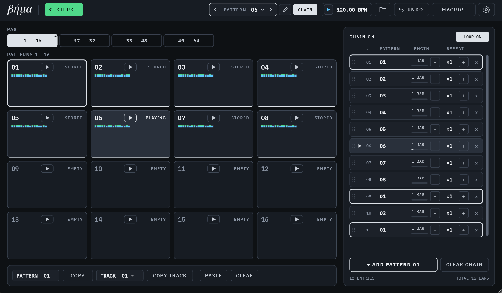<br>
  <em>The patterns view</em>
</p>

### The pattern cells

The four page buttons show patterns 1-16, 17-32, 33-48 and 49-64. A small dot marks the page with the playing pattern.

Each cell shows:

- the pattern number and a **play button**,
- its state: **PLAYING**, **NEXT** (waiting to switch), **STORED** or **EMPTY**,
- a **thumbnail** of the pattern,
- a thin line at the bottom if the pattern is used in the chain

- **Click a cell** to select it.
- **Click its play button** to select and play it. A waiting pattern's play button blinks until the switch happens.

### Reading the thumbnails

Each thumbnail is a tiny picture of the pattern: one row per track, 01 at the top.

- A **green** line is the track's notes, a **cyan** line its CC. Each lit rectangle is a step that is on.
- The line is as long as the track: 32 steps fill the width, 16 half of it.
- A part whose output is **off** is shown dimmed: it holds steps, but you will not hear it.
- A part with no steps on is not shown at all to save space.

<p align="center">
  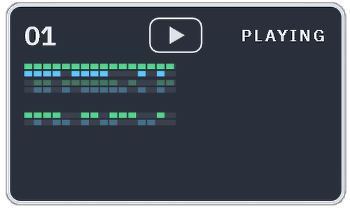<br>
  <em>A pattern cell with on steps in tracks 1, 2, 4 and 7, note out on in tracks 1 and 2, CC out on in tracks 1 and 7 and track 4 with a length of 32 steps</em>
</p>

### Copying patterns and tracks

There are multiple ways to move, copy and paste cells around.

1. The bar under the cells copies whole patterns or single tracks:

<p align="center">
  
</p>

- Use the **TRACK** selector to define the working track for copying - pasting
- **COPY** copies the selected pattern and all its tracks; **COPY TRACK** copies one track of it (the one in the TRACK selector). The button lights up as **COPIED** / **TRACK COPIED**.
- **Click the cell** you want to paste into.
- **PASTE** writes into the selected cell. The button stays lit, so you can select and paste into more patterns. Pasting on an occupied cell overwrites it.
- You can select a different track with one track **copied**, so you can copy track 1 of one pattern into track 3 of another or even copy paste tracks inside the same pattern.
- **CLEAR** clears the clipboard.

2. You can use drag and drop on cells to move around or copy paste them. This works for whole patterns.

<p align="center">
  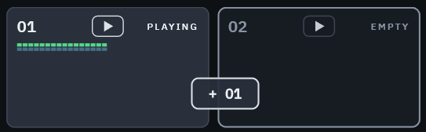<br>
  <em>Pattern 1 drag dropping into pattern 2</em>
</p>

- **Drag a cell** onto another cell to **move** the pattern there. The cell it came from becomes empty.
- **Ctrl + drag** (Cmd + drag on a Mac) to **copy** it instead; the original stays.
- While you drag, the cell under the mouse gets a white outline: that is where the pattern lands. A pattern already in that cell is overwritten.
- **Drag a cell onto the chain list** to add it to the chain exactly where the line shows.

>**design choice:** dragging onto a cell that already holds a pattern overwrites it without asking. Everything you do to patterns in the patterns view can be undone, so a slip is always one UNDO away.

3. You can also **right-click** a **cell** to select it and open its menu:

<p align="center">
  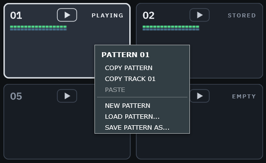
</p>

- **COPY PATTERN** and **COPY TRACK XX**, work the same as the buttons.
- **PASTE**, which says what it will paste: **PASTE PATTERN 05** or **PASTE ON TRACK 03**. A PASTE from this menu is a **one-off**: it pastes into the cell you right-clicked, then clears the clipboard.
- **NEW PATTERN**: resets the pattern to an empty one at once (all steps off, every setting back to its default).
- **LOAD PATTERN...** and **SAVE PATTERN AS...** (explained later).

NEW PATTERN can be undone.

### The chain

<p align="center">
  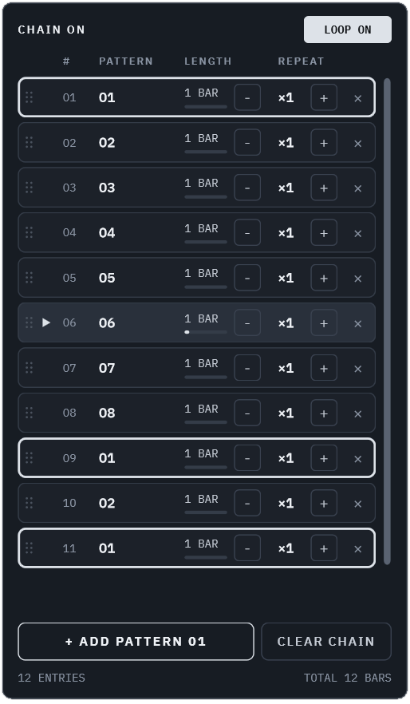<br>
  <em>The chain in patterns view</em>
</p>

Using the chain allows you to chain patterns played one after the other to create longer arrangements. Coupled with copy pasting you can for example have a simple 16 step melody repeated while a CC value changes over the span of 4 bars.

- **+ ADD PATTERN XX** adds the selected pattern at the end.
- You can also **drag a cell** onto the list to put it anywhere. The same pattern can appear many times.

<p align="center">
  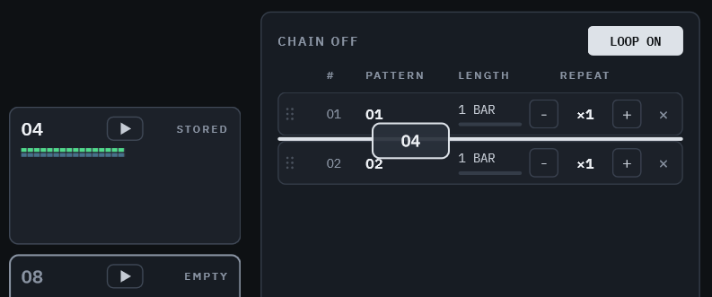<br>
  <em>Pattern 4 dragged to be inserted between patterns 1 and 2 in the chain</em>
</p>

- Each entry shows the pattern, its length in bars and a **repeat** count (- / +, up to 99). The playing entry is brighter, with a small play icon and a progress bar. Every entry of the **selected** pattern has a white outline, so you can see at a glance where it is used.
- **Drag** an entry by its grip to reorder; **x** removes it; **CLEAR CHAIN** empties the chain.
- The **CHAIN** button in the top bar of the plugin starts and stops chain playback. **LOOP ON** goes back to the first entry at the end; **LOOP OFF** plays the chain once and then keeps repeating the last pattern.
- Long chains scroll with the mouse wheel or the scroll bar.
- While a chain is active you can experiment by clicking to play patterns which are not currently in the chain. They will be temporarily inserted and played at the next "switch" of the chain. Once they reach their end, the chain keeps going from where it was interrupted.

>**design choice:** When the DAW starts, the chain always starts from its first entry. (It does not follow the song position like the steps do.) This was a deliberate choice: it keeps editing patterns from the DAW simple.

### Pattern edit mode

Normally the main window always shows the pattern that is playing: when the chain moves on, the view moves with it. Of course, you will often want to work on patterns while a chain is active so you need to have a pattern visible regardless of whether it's currently playing or not. To work on a different pattern while the music keeps going, switch on **pattern edit mode** with the **pencil** button, at the top bar **pattern controls**. It turns pink when on.

<p align="center">
  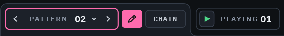<br>
  <em>Pattern selector in pattern edit mode</em>
</p>

While edit mode is on:

- The **PATTERN** selection now chooses the pattern you edit (indicated by the pink outline). The arrows and the quick picker change it **at once**, whatever the Quantize setting, and the playing pattern does not change (to change it, use the play buttons in the patterns view or wait for the chain to progress).
- In the patterns view, the **PATTERN** box shows the selected cell - the one **STEPS** takes you back to - and the arrows move the selection.
- The BPM display switches to a "currently playing pattern indication" - it shows the number of the pattern that is playing. **Click it** to jump to the playing pattern and edit that one.

Switch the pencil off and the main window goes back to the pattern that is playing.


## Macros: automating Vima from your DAW

### One more design choice: Why macros?

A DAW can only automate parameters that a plugin "publishes", and it needs a fixed list of them. Vima has 8 tracks x 64 patterns x 32 steps x 8 values per step: well over 100,000 things you might want to move. No DAW can show a list like that, and nobody could find anything in it.

So Vima publishes **128 macros** instead. Each macro is an empty slot you point at exactly the thing you want to automate. Your DAW sees only those 128, and each one is **named after what it controls**, for example "Vel St05 Tr03 Pat23" (velocity of step 5, track 3, pattern 23) or "Swing Tr03 Pat23". Unused macros are simply "Macro 1", "Macro 2" and so on.

Every macro points at **one fixed thing**: one track, one pattern, one step. It does not follow what is on screen. That is what makes automation reliable: what you record is exactly what plays back.

Macros work both ways: turn a Vima knob that is mapped, and the macro moves too, so you can record your moves in the DAW.

What can be mapped:

- **Global:** Pattern (which pattern plays), Chain On.
- **Track:** Notes Out, CC Out; and per pattern: Length, Division, Direction, Swing, Scale On.
- **Step:** Note On, Pitch, Octave, Velocity, Gate, Probability, CC On, CC Value, CC Probability.


A **Pitch** macro follows the scale like the pitch knob: in C minor it moves through the 7 notes of the scale.

### The Macros view

Open it with **MACROS** button in the top; green **STEPS** button gets you back to the main window.

<p align="center">
  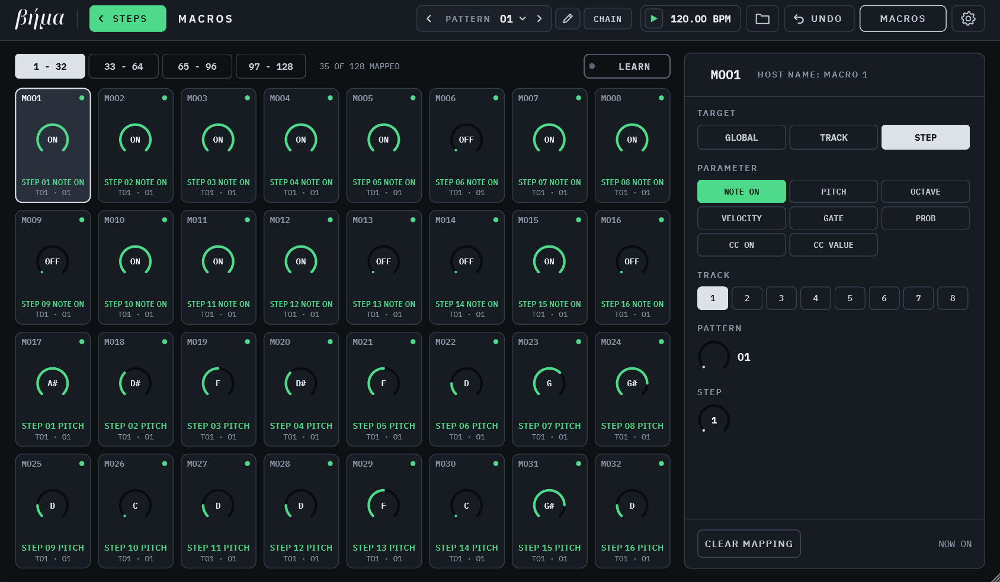<br>
  <em>Macros view</em>
</p>

In **Macros view** 4 pages of 32 macros are displayed. Each macro cell shows its number, a knob with the current value, what it controls ("STEP 05 VEL") and where ("T04 · 06" = track 4, pattern 06).
Next to the macros cells is the editor for the selected macro. Choose **TARGET** (GLOBAL / TRACK / STEP), **PARAMETER**, and the **TRACK**, **PATTERN** and **STEP** it points at. **CLEAR MAPPING** empties it. You can either manually assign a macro to a parameter using the editor or use the **Learn** function.

### LEARN: mapping by clicking

The quickest way to map multiple macros to parameters is using the **Learn** function.

1. Press **LEARN**. The selected macro (or the next free one) starts listening; the header button reads "LEARN M00X" in amber.
2. Go to the step view or the patterns view and **click the control** you want to automate: a step's velocity, a track's swing, a pattern cell...
3. The macro is mapped to that control (on the track and pattern you are looking at), and LEARN moves on to the next free macro. Keep clicking to map more.
4. Press LEARN again to stop.

While learning, every mapped control shows an amber outline with its macro number. A control can only have one macro: clicking a mapped one does nothing. **Right-click** a mapped control to free it.

<p align="center">
  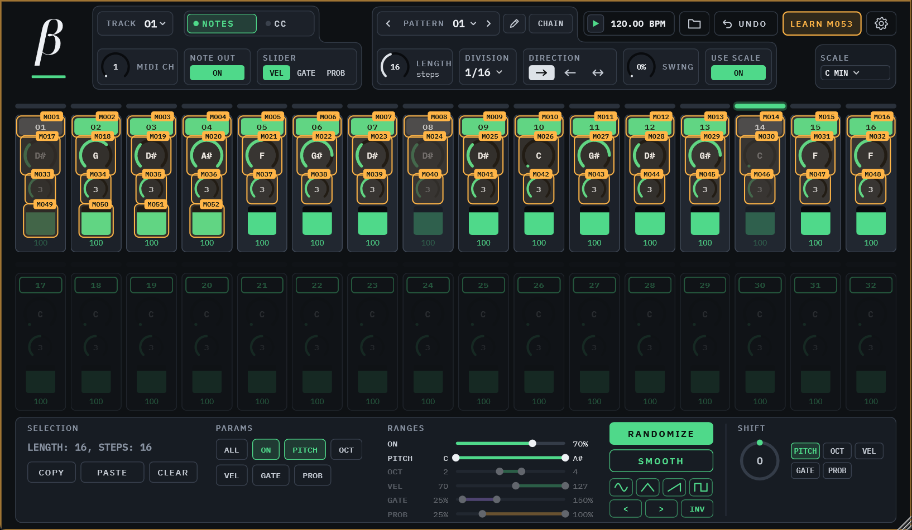<br>
  <em>Parameters mapped in learn mode</em>
</p>

Then, in your DAW, automate or map hardware knobs to the macros as you would with any plugin parameter.

## UNDO & REDO

<p align="center">
  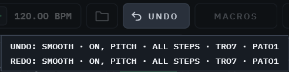
</p>

UNDO steps back through your edits, up to 64 steps. It covers everything stored in patterns: step edits, track settings per pattern, copy / paste, randomize, smooth, curves, shift and pattern pastes. One gesture is one undo step (a whole knob move, a whole slider drawing, a whole hold of SMOOTH). **Right-clicking UNDO** performs a REDO.

Routing (channel, outputs, CC number), global settings, the chain and macro mappings are not part of undo.


## TRANSPORT

By default, Vima simply follows your DAW start - stop and the **steps follow the song position.** Step 1 of every track falls on bar 1, beat 1 of your song and on every repeat of the track's length after it. Start the DAW anywhere and every track is on the right step.

The **transport** section of Vima at the top displays your DAW's BPM. The **play - stop** has been designed to understand your intentions without complicated options ("smart" following - or not - your DAW transport).

- Press **stop while the DAW plays**: Vima stops and stays stopped (the icon turns **amber**: "held") until you press its play button again, even if the DAW stops and starts in between. Handy for muting the whole sequencer without touching the DAW.
- Press **play while the DAW is stopped**: Vima runs on its own from step 1 at the DAW's tempo, to audition ideas without starting the song.


## SCALE

Vima can be set to send note messages in a defined scale. Clicking the **SCALE** button on the right opens a pop up to pick a root and one of 13 scales or your own USER scale (defined in Settings window). The mouse wheel over it steps through the scales.

<p align="center">
  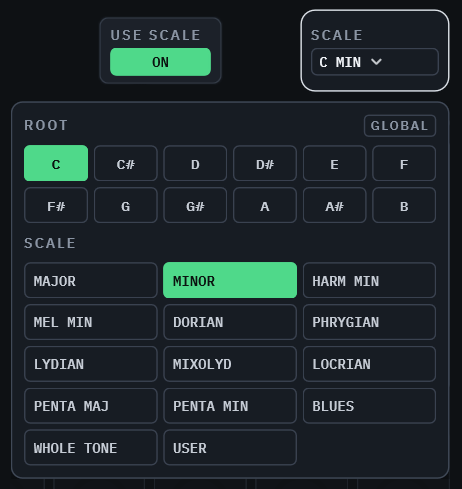
</p>

>**Design choice: why is SCALE global?** Most electronic music stays in one key and one scale. A global scale means you set it once and every track agrees. For tracks that should ignore it just switch USE SCALE off. USE SCALE is stored per pattern, so a track can follow the scale in one pattern and ignore it in another.


## Saving: presets, patterns and macro sets

Every Vima in your project saves its **complete** state with the project: all patterns, the chain, routing, scale, settings, macro mappings and window size. Each Vima instance keeps its own: two Vimas in the same project can have completely different settings. You never need to save a preset just to keep your work.

The files button opens a menu to save presets, patterns and macro mappings.

>**design choice:** instead of having a "preset" system that saves everything, saving is "modularized" into three distinct categories: "presets" for saving everything but macros which allows for easy transferring of your work between projects or even DAWs, "patterns" for saving individual sequences and melodies ready to be re-used in the same DAW project or a new one and "macros" which might be desired to be re-used in new projects with new sequences and melodies.

### The FILE menu

Clicking the **file** button (with a folder icon) at the top of the plugin opens the file menu.

<p align="center">
  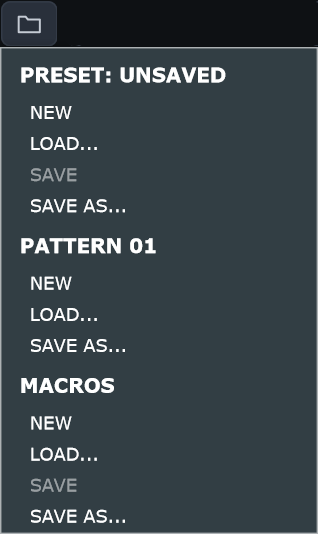
</p>

**PRESET**: the music of the whole instance.

- Holds all 64 patterns, the chain, the track routing, the scale, root and user scale, the PARAMS and RANGES, and the current pattern.
- Does **not** hold the macro mappings, the settings found only in the Settings dialog (CC smoothing and its curve, pattern change by CC, quantize), the theme, middle C or the window size. Loading a preset leaves all of those as they are.
- **NEW** loads a new init preset: all tracks 16 steps long, 1/16 division, track 1 with all its note steps on.
- **LOAD...** loads a saved preset.
- **SAVE** saves changes to a loaded preset (greyed out if no saved preset is loaded).
- **SAVE AS...** saves the current preset to a new file.
- The menu header shows the current preset's name, or "UNSAVED".
- Files end in **.vima** and are kept in Documents/Vima/Presets by default.

**PATTERN**: one single pattern.

- Works on the **selected pattern** (the one in the PATTERN box, or the selected cell in the patterns view).
- Holds the pattern's 8 tracks: their steps and their length, division, direction, swing and use scale. No routing, no scale: a loaded pattern plays in the current scale.
- **NEW** resets the pattern to an empty one (all steps off, every setting back to its default).
- **LOAD...** loads a saved pattern.
- **SAVE AS...** saves the current pattern to a file.
- Both NEW and LOAD can be undone.
- Files end in **.vimapattern**, in Documents/Vima/Patterns.

You can also save or load a pattern by right-clicking a cell in the patterns view.

**MACROS**: all 128 macro mappings, as a set.

- Handy for a mapping you use with a hardware controller, or a standard set of automation targets.
- **NEW** clears all mappings and asks first. **LOAD...** asks before replacing existing mappings. **SAVE** and **SAVE AS...** work like presets.
- Loading a macro set never touches your music, and loading a preset never touches your mappings.
- Files end in **.vimamacros**, in Documents/Vima/Macros.

Your DAW's own preset system (for example Live's .adv or .vstpreset files) also works and stores everything, mappings included.


## The Settings window

The **settings** pop up opens with the **SETTINGS** button (the gear icon). Click **DONE** or anywhere outside it to close.

<p align="center">
  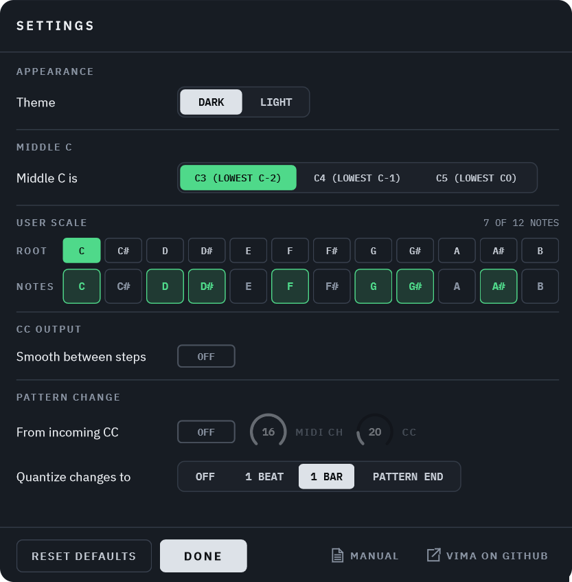
</p>

**APPEARANCE: Theme**, DARK or LIGHT. This is **your** preference: it applies to every Vima in every project, and switching it in one Vima switches all open ones.

<p align="center">
  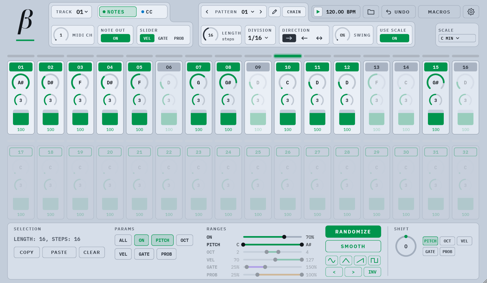<br>
  <em>OF COURSE I would include one</em>
</p>

**MIDDLE C: Middle C is** C3, C4 or C5. This only changes how octaves are **numbered** on screen (MIDI note 60 is always middle C), so Vima can match your DAW: C3 for Live, Bitwig, Logic, Cubase, Studio One, Pro Tools and Reason; C4 for Reaper and Tracktion; C5 for FL Studio, Cakewalk and Renoise. Like the theme, it is your preference for every Vima.

**USER SCALE**: build your own scale. Choose the **root** and switch the 12 notes on or off (the root is always on). Then pick **USER** in the SCALE pop up. The root here is the same as the one in the SCALE pop up.

**CC OUTPUT: Smooth between steps**: Smoothing is on by default: each track's CC glides from one CC step's value to the next instead of jumping. With smoothing off, each CC step sends its CC value as is, so when two adjacent steps have a big difference in values the controlled parameter "jumps" - which is what you want for stepped parameters like a waveform selector or a switch. Target a synth parameter with the CC steps and you'll see at once what I mean. Which mode you prefer depends on the actual synth parameter controlled and personal taste and the sound you're after.

**Curve**: the shape of the glide while smoothing is on. **LINEAR** moves evenly from one value to the next. **EXP** starts slow and speeds up into the next value, **LOG** moves fast first and then settles into it. Parameters like filter cutoff often sound more natural with EXP or LOG, since our ears don't hear their changes evenly. Like smoothing, the curve applies to every track.

**PATTERN CHANGE**:
**From incoming CC**: You can use this setting to switch patterns with a CC message, on the MIDI channel and CC number you set. Value 0 picks pattern 01, value 63 picks pattern 64. Great for switching patterns from a hardware controller or from another track in your DAW.

**Quantize changes to**: OFF, 1 BEAT, 1 BAR or PATTERN END. This controls how the patterns switch when selected manually:
- **OFF**: instantly, at the moment you pick it. Every track carries on at the right step, so the groove never stumbles.
- **1 BEAT** / **1 BAR**: at the next beat or bar of your DAW's time signature (1 BAR is the default setting).
- **PATTERN END**: when the playing pattern reaches its end.

**RESET DEFAULTS** puts everything in this dialog back to its starting value. The theme and middle C are reset for every Vima; the scale you selected is kept.

Except for the theme and middle C, these settings belong to each Vima in your project and are saved with the project, but not in presets: a preset is about the MIDI output setup, these are about how the instance is set up.


## Appendix: Mouse quick reference

| Where | What you do | What happens |
|---|---|---|
| Knobs | drag up / down | change the value (Shift = fine) |
| Knobs and sliders | mouse wheel | one value per notch |
| Knobs and sliders | double-click | type a value |
| Knobs and sliders | right-click or Alt + click | reset to default |
| Step sliders | click | the value jumps to the click |
| Step sliders | click and drag across steps | draw values |
| Step sliders | Shift + drag | fine control of that one step |
| Step buttons | click / drag across | switch on or off / paint |
| LED bar | click / drag | select one step / a run |
| LED bar | Ctrl + click / Ctrl + drag | add or remove steps / add a run |
| SMOOTH | press and hold | keep smoothing |
| SHIFT | drag / wheel | shift values (springs back to 0) |
| DIVISION, SCALE | mouse wheel | next / previous value |
| Range bars | click / drag | move the nearest handle |
| Range bars | Shift + drag | fine control |
| Range bars | right-click or Alt + click | reset to default |
| PATTERN box | click the number / the arrows | quick picker / previous or next pattern |
| Pencil | click | pattern edit mode on / off |
| Pattern cell | click / play button | select / select and switch |
| Pattern cell | right-click | copy, paste, new, load, save menu |
| Pattern cell | drag / Ctrl + drag | move / copy onto another cell |
| Pattern cell | drag onto the chain | add it to the chain there |
| Page buttons | hover while dragging a cell | switch page |
| Chain entry | drag the grip | reorder |
| PLAYING (edit mode) | click | edit the playing pattern |
| UNDO | hover | shows the next undo and redo |
| UNDO | right-click | REDO the last UNDO |
| While LEARN is on | click / right-click a control | map it / free it |

On a Mac, Alt is Option, and Ctrl + click for selecting steps (and Ctrl + drag for copying a pattern) is Cmd.


## Building

```
cmake -S . -B build
cmake --build build --config Release --target Vima_VST3
```

JUCE 8.0.8 is downloaded automatically. Use `-DJUCE_DIR=/path/to/JUCE` for a local checkout.
Tests: configure with `-DVIMA_BUILD_TESTS=ON`, build `VimaTests`, run it. It runs the engine
checks offline and writes screenshots of every screen.

## License

AGPL-3.0, see [LICENSE](LICENSE). IBM Plex fonts: SIL Open Font License, see
`Resources/fonts/OFL-IBMPlex.txt`.
